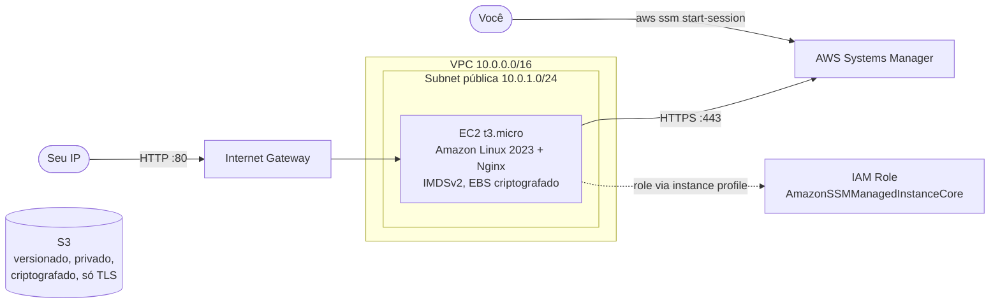

# terraform-aws-infra-modular

Projeto de estudo de **Infraestrutura como Código** com Terraform na AWS. Ele provisiona uma
VPC pública com uma instância EC2 servindo uma página no Nginx e um bucket S3 endurecido, tudo
dividido em módulos reutilizáveis.

> Projeto para aprendizado e portfólio. Antes de usar em produção, revise custos, região e
> requisitos de segurança do seu ambiente.

## Arquitetura



## Módulos

| Módulo | O que cria |
|---|---|
| `vpc` | VPC, subnet pública, Internet Gateway, route table e trava do security group default |
| `security_group` | SG com HTTP só para os CIDRs informados. **Sem porta 22** |
| `iam` | Role da instância + instance profile, com a policy mínima para o SSM |
| `ec2` | Instância Amazon Linux 2023 (AMI resolvida via SSM Parameter), IMDSv2 obrigatório, disco gp3 criptografado, Nginx via `user_data` |
| `s3` | Bucket com versioning, bloqueio de acesso público, criptografia, lifecycle de versões antigas e policy que recusa acesso sem TLS |

## Decisões de segurança

- **Acesso à instância via SSM Session Manager, não SSH.** Não há porta 22 aberta nem chave para vazar, e cada sessão fica registrada no CloudTrail.
- **Role em vez de usuário IAM.** A instância recebe credenciais temporárias pelo instance profile, sem access key estática.
- **IMDSv2 obrigatório.** Protege as credenciais da role contra ataques de SSRF.
- **AMI dinâmica.** O ID vem do parâmetro público `/aws/service/ami-amazon-linux-latest/...`, então não quebra quando uma AMI antiga é removida.
- **S3 privado por padrão.** Bloqueio de acesso público, `BucketOwnerEnforced`, criptografia e negação de tráfego sem TLS.
- **Versões fixas.** Terraform `>= 1.5` e provider AWS `~> 6.0`, com `.terraform.lock.hcl` versionado.

## Pré-requisitos

- [Terraform](https://developer.hashicorp.com/terraform/install) >= 1.5
- AWS CLI configurado (`aws configure` ou SSO)
- [Session Manager plugin](https://docs.aws.amazon.com/systems-manager/latest/userguide/session-manager-working-with-install-plugin.html) para abrir terminal na instância

## Como usar

```bash
git clone https://github.com/zHanyaa/terraform-aws-infra-modular.git
cd terraform-aws-infra-modular

cp terraform.tfvars.example terraform.tfvars
# edite bucket_name (único globalmente) e allowed_http_cidrs (ex.: "SEU_IP/32")

terraform init
terraform plan
terraform apply
```

Depois do apply:

```bash
# página do Nginx (a partir de um IP liberado em allowed_http_cidrs)
curl "http://$(terraform output -raw public_ip)"

# terminal na instância, sem SSH
$(terraform output -raw ssm_session_command)
```

Para destruir tudo:

```bash
terraform destroy
```

Se o bucket tiver objetos, defina `bucket_force_destroy = true` antes do destroy.

## Variáveis

| Nome | Padrão | Descrição |
|---|---|---|
| `aws_region` | `us-east-1` | Região AWS |
| `project_name` | `infra-modular` | Prefixo dos recursos |
| `environment` | `dev` | Ambiente, usado no prefixo e nas tags |
| `vpc_cidr` | `10.0.0.0/16` | CIDR da VPC |
| `public_subnet_cidr` | `10.0.1.0/24` | CIDR da subnet pública |
| `instance_type` | `t3.micro` | Tipo da instância |
| `allowed_http_cidrs` | `[]` | CIDRs liberados na porta 80 |
| `bucket_name` | — (obrigatória) | Nome do bucket S3 |
| `bucket_force_destroy` | `false` | Permite destruir o bucket com objetos |

## CI

O workflow `.github/workflows/terraform.yml` roda a cada PR:

1. `terraform fmt -check`
2. `terraform validate`
3. `tflint` (regras recomendadas do Terraform + ruleset AWS)
4. `checkov` (análise de segurança). Os checks ignorados de propósito estão em `.checkov.yaml`, cada um com o motivo.

## Custo estimado

Com `t3.micro`, o custo fica em torno de US$ 8/mês fora do free tier, mais o IPv4 público
(~US$ 3,60/mês). Rode `terraform destroy` quando terminar de estudar.

## Próximos passos

- [ ] Backend remoto (S3 com lock nativo) para o state
- [ ] Subnets privadas em duas AZs, com VPC endpoints para o SSM
- [ ] Ambientes separados (dev/prod) com workspaces ou Terragrunt

## Autor

**Gustavo Pina**: [LinkedIn](https://www.linkedin.com/in/gustavopina-devops/) · [GitHub](https://github.com/zHanyaa)
